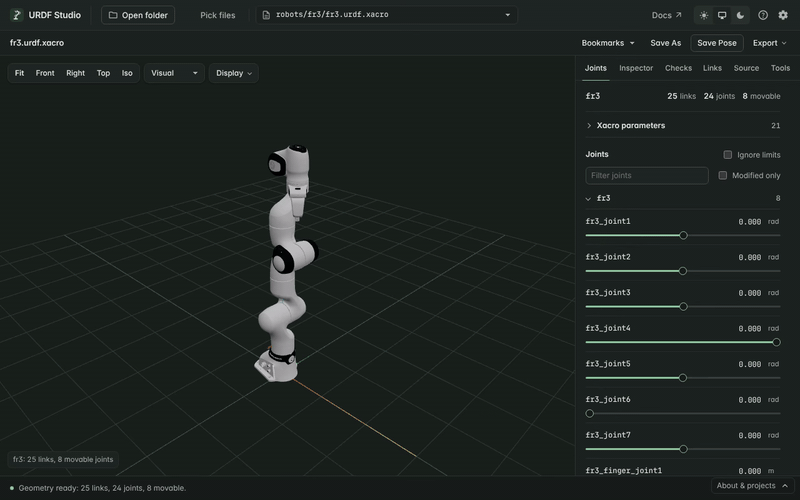
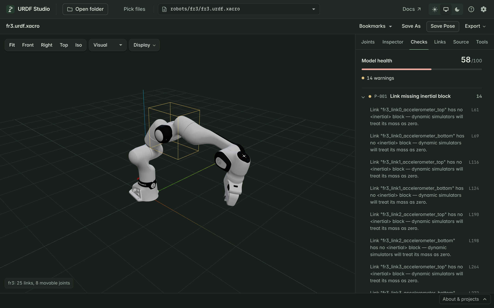
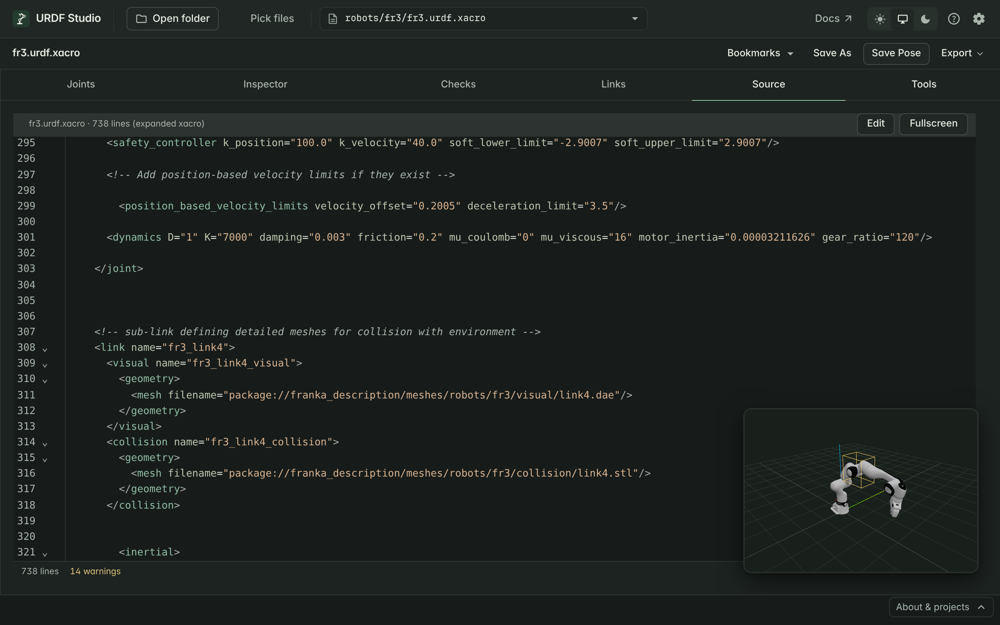
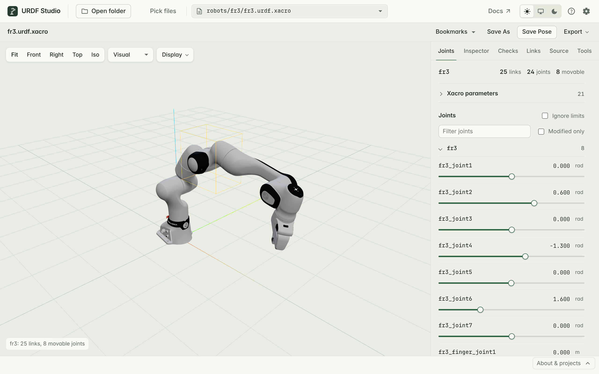
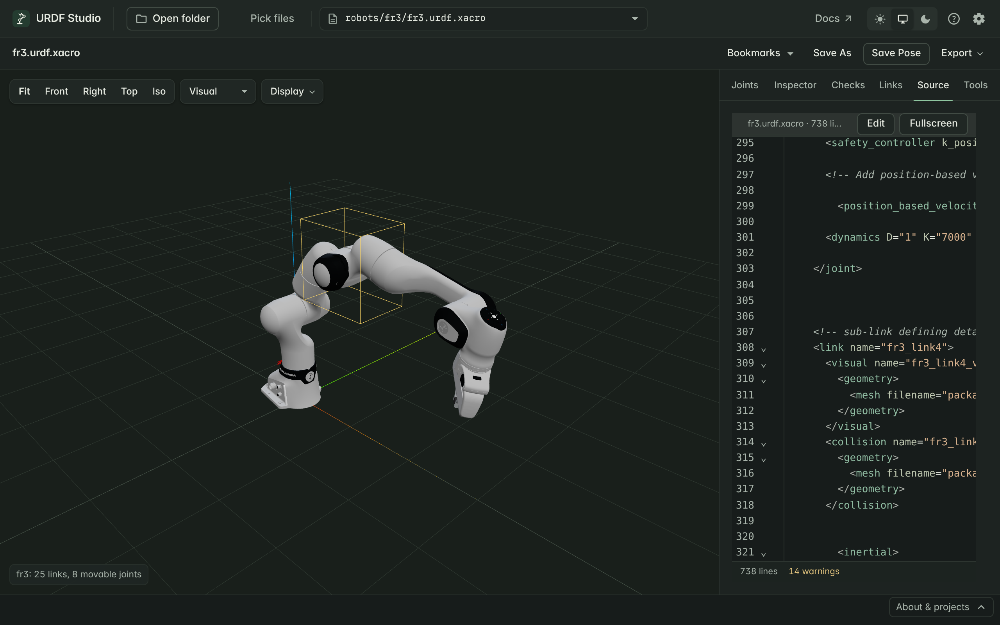
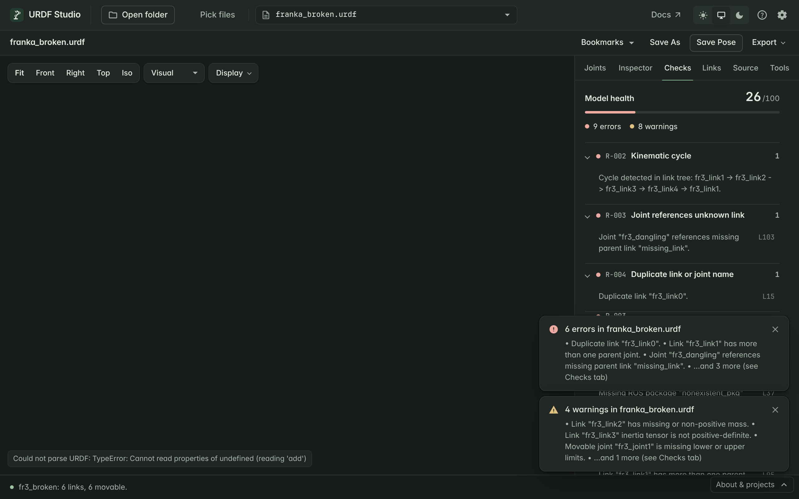

<h1 align="center">
  
   
  URDF&nbsp;Studio
</h1>

  <strong>See, pose and check robot models — URDF, xacro and MuJoCo MJCF — in your browser or in VS Code.</strong>

  <a href="https://urdf.deyuf.org"><strong>Open in browser</strong></a> ·
  <a href="https://marketplace.visualstudio.com/items?itemName=deyuf.urdf-studio"><strong>Install for VS Code</strong></a> ·
  <a href="https://urdf.deyuf.org/docs/"><strong>Documentation</strong></a>

  
  
  

  

URDF Studio opens `.urdf` and `.xacro` robot descriptions and MuJoCo
(MJCF) models with their meshes and shows the robot in 3D. Move every joint, click any part to see
what it is, compare visual and collision geometry, and get a list of
problems in the model — each linked to the line that causes it.

No ROS installation is needed. In the browser, your files are read
locally and never uploaded.

## What you can do

- **Look at the robot** — orbit, zoom, camera presets; visual geometry,
  collision geometry, or both at once.
- **Pose it** — a slider and exact value for every joint. Mimic joints
  follow, SRDF named states are one click, limits can be ignored to
  explore.
- **Find problems** — missing meshes, broken links in the tree, impossible
  inertias, missing limits, unused xacro arguments — with one-click fixes
  for the common ones.
- **Inspect** — per-link mass, centre of mass, inertia, joint axis and
  limits; coordinate frames, labels and inertia ellipsoids in 3D.
- **Edit with live preview** — change the URDF and see the robot update as
  you type.
- **Prepare for MoveIt** — find link pairs that never collide and write
  them to your SRDF; see where the arm can reach.
- **Share** — save poses and bookmarks, export a PNG, joint values (JSON),
  a parts list (CSV) or an inspection report (PDF).
- **Open MuJoCo models** — view MJCF read-only with the same tools, and
  save it as URDF. Tested against MuJoCo Menagerie robots.

## Get started

### In the browser

1. Go to **[urdf.deyuf.org](https://urdf.deyuf.org)**.
2. Click **Open folder** — or drag a folder onto the page — and choose the
   folder that contains your package's `package.xml`.
3. Pick a robot from the list.

Works best in Chrome, Edge and other Chromium-based browsers. In Firefox
and Safari, use **Pick files** instead.

Don't have a robot to hand? Try
[`franka_description`](https://github.com/frankarobotics/franka_description).
The [first-robot walk-through](https://urdf.deyuf.org/docs/quickstart/)
takes about two minutes.

### In VS Code

1. Install **URDF Studio** from the
   [Marketplace](https://marketplace.visualstudio.com/items?itemName=deyuf.urdf-studio).
2. Open your ROS workspace folder.
3. Open any `.urdf` or `.xacro` file — it opens in the 3D preview.

In the text editor you also get problems in the Problems panel, quick
fixes, hover information, go to definition and an outline of links and
joints.

## Screenshots

*Checks: every problem, grouped by kind, each one linked to its line.*

*Edit the URDF full screen; the robot updates in the corner as you type.*

More screenshots

## Documentation

Full documentation is at **[urdf.deyuf.org/docs](https://urdf.deyuf.org/docs/)**:

- [Your first robot](https://urdf.deyuf.org/docs/quickstart/)
- [Pose the robot](https://urdf.deyuf.org/docs/features/joints.html)
- [Find and fix problems](https://urdf.deyuf.org/docs/features/diagnostics.html)
- [Packages, xacro args and settings](https://urdf.deyuf.org/docs/features/settings.html)
- [Troubleshooting](https://urdf.deyuf.org/docs/help/)

## Common questions

**Meshes don't show up.** Open the folder that contains `package.xml`, not
a subfolder, and make sure every package the robot uses is inside it. More
in [Troubleshooting](https://urdf.deyuf.org/docs/help/#meshes-are-missing).

**Do I need ROS installed?** No. Xacro is expanded by URDF Studio itself,
including `$(find …)`, `xacro:include`, macros and `load_yaml`.

**Which formats are supported?** URDF, xacro, SRDF and MuJoCo MJCF
(read-only); STL, COLLADA, OBJ, glTF and GLB meshes. See
[Supported files and browsers](https://urdf.deyuf.org/docs/reference/formats.html).

**Is my robot model uploaded?** No. The browser version reads your files
on your computer; the extension runs entirely inside VS Code.

## Feedback and contributing

Found a bug or have a model that doesn't load? Please
[open an issue](https://github.com/deyuf/urdf-studio/issues).

Want to work on URDF Studio itself? See [CONTRIBUTING.md](CONTRIBUTING.md)
for building, testing and how the code is organised.

URDF Studio is free and open source under the [MIT license](LICENSE).
