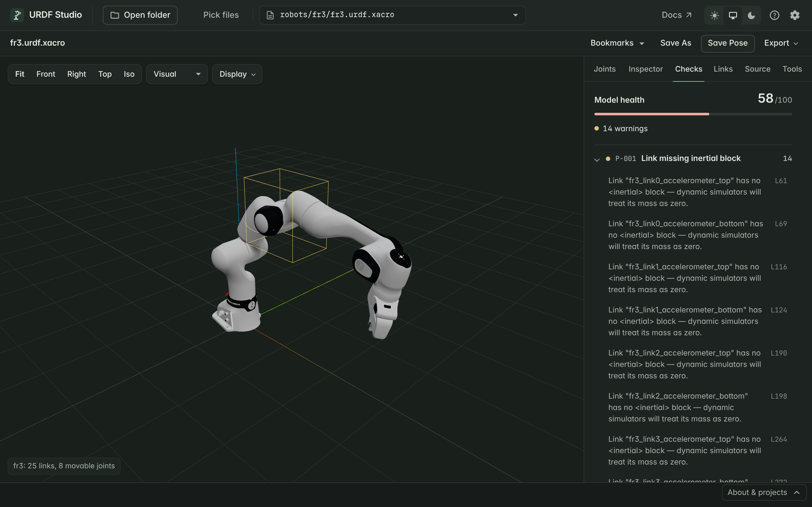

# Find and fix problems

Every time a robot loads, URDF Studio checks it for problems that break
loading, confuse simulators, or are likely mistakes. Results are in the
**Checks** tab and, in VS Code, the Problems panel.

## Reading the Checks tab

At the top:

- **Model health** — a score out of 100. It starts at 100 and drops by 10
  for each error, 3 for each warning and 0.5 for each info. Treat it as a
  rough progress meter while you clean up a model, not as a grade.
- **Counts** of errors, warnings and info items.

Below, problems are grouped by check. Each group shows a code such as
`P-001`, a short name and how many times it was found. Click any problem to
open the **Source** tab at that line.

When something serious goes wrong while loading — the file isn't valid XML,
or xacro can't be expanded — a message also pops up in the corner. Errors
stay until you close them; warnings fade.

## What the severities mean

| Severity | Meaning | What to do |
|---|---|---|
| Error | Something is broken: the robot may not load, or loads wrong | Fix before using the model |
| Warning | Likely a mistake, or something a simulator or planner will trip on | Look at each one; most are worth fixing |
| Info | Tidiness and suggestions | Fix when convenient |

## Common problems and fixes

**A link has no `<inertial>` block (`P-001`).** Simulators treat it as
massless, and Gazebo may ignore it entirely. Fine for pure frames such as
`tool0` or sensor mounts; for real parts, add mass and inertia.

**A joint has no limits (`P-004`).** Revolute and prismatic joints need
`<limit lower upper effort velocity>`. Without one, many tools refuse the
model or treat the joint as frozen.

**A mesh can't be found (`A-001`).** Usually the folder you opened doesn't
contain the package the path points to. See
[Troubleshooting](../help/#meshes-are-missing).

**A joint names a link that doesn't exist (`R-003`).** Often a typo, or a
xacro prefix applied in one place but not the other.

The full list, with what triggers each check, is in the
[Checks reference](../reference/checks.html).

## Quick fixes

Some problems can be fixed with one click. They insert a reasonable
placeholder that you should then adjust:

- Missing `<limit>` → inserts a default limit.
- Missing `<inertial>` → inserts a small default inertial.
- Invalid mass → sets mass to 1.0.
- Zero effort or velocity → sets effort 100 and velocity 1.0.
- `<limit>` on a continuous joint → removes the angular limits.

In the **Source** tab, turn on **Edit**, then use the fix offered on the
underlined line. In VS Code, use the light bulb in the text editor.

## Xacro files

For a `.xacro` file, checks run on the expanded result, so line numbers
refer to the expanded URDF shown in the Source tab — not to your xacro
source. Search your xacro for the link or joint name to find the place to
change.

If an expression in your xacro can't be evaluated, URDF Studio skips it and
expands the rest so you still get a robot to look at. A warning tells you
which expression was skipped.
