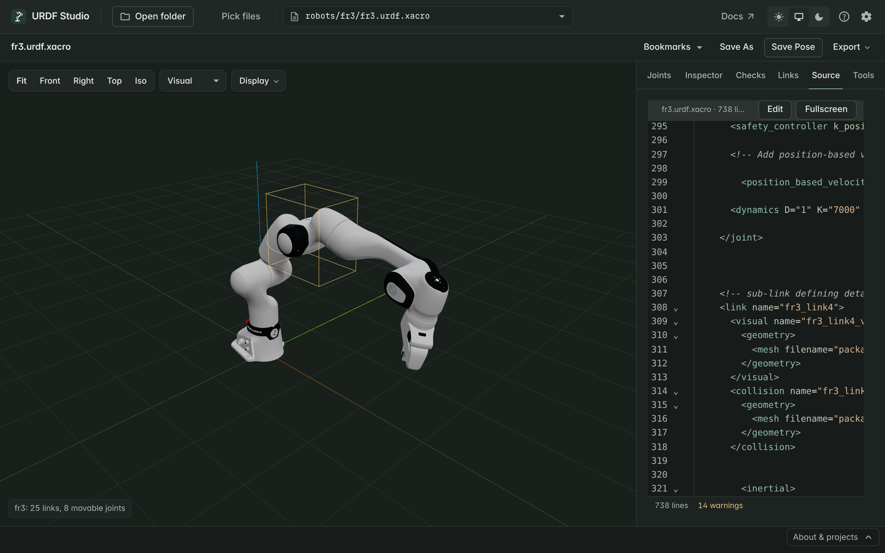

# Edit the source

The **Source** tab shows the robot's URDF. Turn on editing and the 3D view
updates as you type — handy for nudging an origin, fixing a limit, or
trying a different mesh.

## Read the source

The Source tab is read-only at first. It highlights:

- the line of the selected link, and
- every problem from [Checks](./diagnostics.html), underlined in place.

Click a problem in the Checks tab to land on its line.

## Edit with live preview

1. Click **Edit** at the top of the Source tab.
2. Change the text. About a sixth of a second after you stop typing, the
   3D view reloads with your change. Your pose is kept.
3. Checks update at the same time, so you see straight away whether a
   change fixed a problem or introduced one.

While editing:

- **Completion** suggests link names inside `parent link="…"` and
  `child link="…"`, joint types, and package names in `package://` paths.
- **Quick fixes** are offered on underlined lines — see
  [Find and fix problems](./diagnostics.html#quick-fixes).

## Work full screen

Click **Fullscreen**, or press **F11** or **Ctrl+Shift+F** (**⌘⇧F**), to
give the editor the whole window. The 3D view shrinks into a corner so you
still see the effect of each change. Press the same key to return.

## Save your changes

Press **Ctrl+S** (**⌘S**) in the editor.

| File | Browser | VS Code |
|---|---|---|
| `.urdf` | Downloads the edited file; the original in your folder is not changed | Writes the file |
| `.xacro` | Downloads the expanded result as `<name>.urdf` | Asks where to save the expanded result as a `.urdf` |
| MJCF (`.xml`, `.mjcf`) | Downloads the converted URDF as `<name>.urdf` | Asks where to save the converted URDF |

## Editing xacro files

For a `.xacro` file, the Source tab shows the **expanded URDF**, not your
xacro source: macros, properties and includes have already been resolved.
Live preview still works, which makes it a good place to try a change
quickly.

Saving never writes over the `.xacro` file — the expanded text would lose
its macros and includes. The same applies to MuJoCo models, whose Source
tab shows the [converted URDF](./mjcf.html). Make lasting changes in your xacro source, in
your usual editor.
