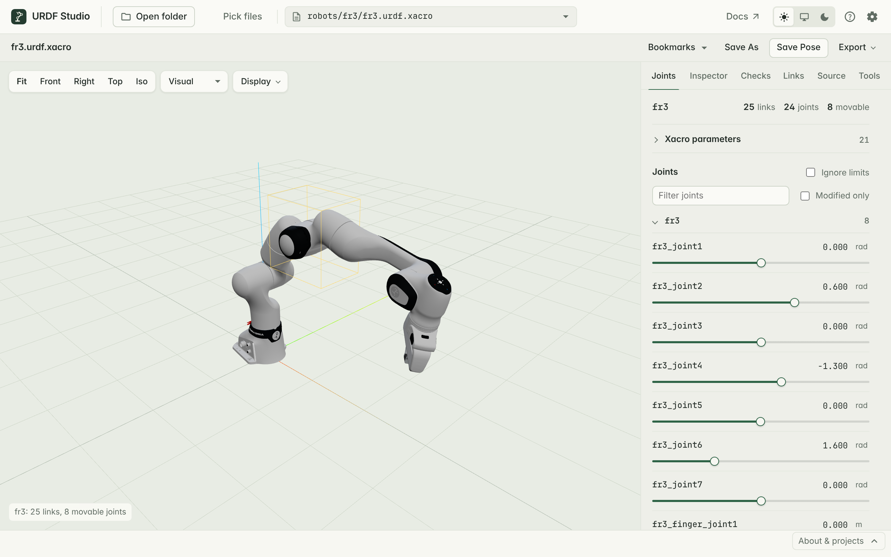

# Pose the robot

The **Joints** tab lists every joint that can move. When an SRDF is
loaded, joints are grouped by its planning groups.

## Move a joint

- **Drag the slider** to move the joint and watch the robot follow.
- **Type a value** in the number field for an exact position. Revolute and
  continuous joints are in radians (`rad`), prismatic joints in metres
  (`m`).

The slider covers the range in the joint's `<limit>`. Continuous joints go
from −π to π.

Fixed joints are not listed because they can't move.

## Reset

- **Reset** next to *Joints* moves every joint back to zero. Mimic joints
  follow.
- A joint you have moved shows a reset button beside its value; click it to
  reset just that joint. Double-clicking the slider does the same.

When zero is outside a joint's limits — the Franka FR3's fourth joint, for
example, only bends between −3.08 and −0.12 rad — reset moves it to the
nearest limit instead. Such a joint shows as moved when a robot first opens,
because it starts at an invalid 0.

## Find a joint

On robots with many joints:

- Type in **Filter joints** to show only joints whose name contains that
  text.
- Tick **Modified only** to show only joints you have moved away from
  zero (or from the nearest limit, see [Reset](#reset)).

## Go past the limits

Tick **Ignore limits** to move joints outside their `<limit>` range. It's
useful to see what the hardware could physically do, or to check whether a
limit is set wrongly. It turns off again when you open another robot.

## Mimic joints

A joint with `<mimic joint="…" multiplier="…" offset="…"/>` follows another
joint, as grippers often do. It has no slider of its own: move the joint
it follows, and it moves too, by `multiplier × value + offset`.

If a mimic points at a joint that doesn't exist, it shows up in
[Checks](./diagnostics.html) as `R-005`.

## Named states from SRDF

If the package has an SRDF with `<group_state>` entries — `ready`, `home`,
`transport` and so on — each group shows them as buttons above its joints.
Click one to apply that pose.

URDF Studio looks for `.srdf` files and `initial_positions.yaml` in each
package's `config/` folder. To use other files, add them under
**Semantic files** in [settings](./settings.html).

## Change xacro parameters

For a `.xacro` file, **Xacro parameters** at the top of the Joints tab
lists the file's `xacro:arg` values — for example which hand is attached,
or the robot's name prefix. Change values and click **Reload xacro**.

To use the same values every time, set **Default xacro args** in
[settings](./settings.html).

## Keep a pose

Click **Save Pose** in the toolbar to keep the current pose, or add it to
**Bookmarks** under a name. See [Save poses and export](./poses.html).
