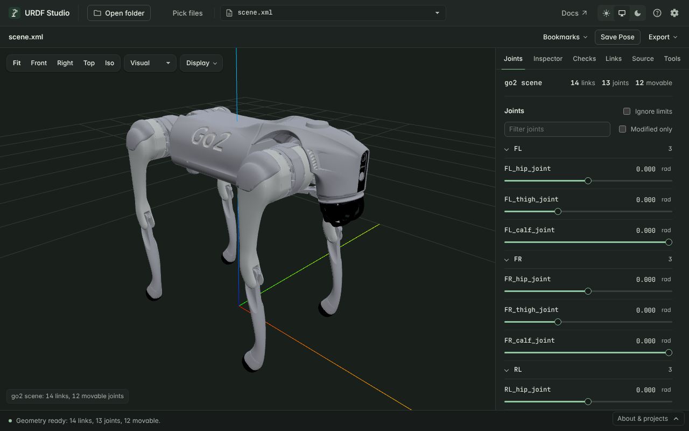

# View MuJoCo (MJCF) models

URDF Studio opens MuJoCo models (MJCF, the `<mujoco>` XML format) read-only.
Joints, the Inspector, Checks, collision view, measuring and exports all work
the same way as for URDF.

## Open a model

Open the folder that contains the model, as you would a ROS package — for
example one robot from [MuJoCo Menagerie](https://github.com/google-deepmind/mujoco_menagerie).
URDF Studio finds every `.xml` file whose root element is `<mujoco>` and lists
it with the other robot files. Menagerie's `scene.xml` (robot plus floor and
lights) is listed first.

In VS Code, `.mjcf` files open in the preview directly. For `.xml` files,
use the **Open Preview** button in the editor title bar or the **URDF Studio:
Open Preview** command; the file must be a MuJoCo model.

Include the whole model folder: meshes and `<include>` files are found
relative to the main model file and its `meshdir`.

## How MJCF is shown

URDF Studio converts the model to URDF for display. The **Source** tab shows
that URDF, marked *converted from MJCF*. Your MJCF file is never changed;
**Ctrl+S** in the Source tab saves the converted URDF as a separate `.urdf`
file, which is a handy way to get a URDF from an MJCF model.

| MJCF | Shown as |
|---|---|
| `<body>` | A link |
| `hinge` joint | Revolute joint, or continuous when it has no limits |
| `slide` joint | Prismatic joint |
| Several joints in one body | A chain of joints, in the same order |
| `ball`, `free` joint | Fixed — URDF has no equivalent |
| Geoms in groups 0–2 | Visual geometry |
| Geoms that collide (`contype` / `conaffinity` not both 0) | Collision geometry |
| `capsule` | A cylinder with a sphere at each end |
| `ellipsoid` | A sphere of the largest radius |
| Infinite `plane` (the floor) | Not drawn — the 3D view has its own grid |

Default classes, `childclass`, `<frame>`, `<include>`, `fromto`, every
orientation form (`quat`, `euler` with `eulerseq`, `axisangle`, `xyaxes`,
`zaxis`) and `angle="degree"` are supported. Joint positions match MuJoCo's
own kinematics.

When something can't be shown exactly — a ball or free joint, an
ellipsoid, a height field — a note appears under **Loading problems** in the
Checks tab, naming what was approximated.

## Differences from URDF to keep in mind

- **No "missing inertia" warnings.** MuJoCo computes mass and inertia from the
  geoms when a body has no `<inertial>`, so check `P-001` is skipped.
- **Floating bases stay put.** A body with a free joint, such as a legged
  robot's base, is drawn at its starting position. Its leg joints move
  normally.
- **Not shown:** actuators, tendons, equality constraints, sensors, sites,
  textures, height fields and meshes defined by inline vertices.
