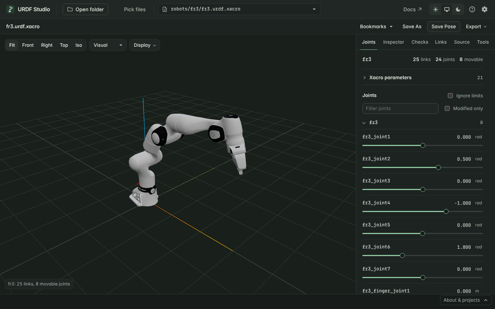

# URDF Studio

URDF Studio opens robot descriptions — ROS `.urdf` and `.xacro` files and
MuJoCo MJCF models, with their meshes — and shows the robot in 3D. You can
move every joint, click any part to see what it is, and get a list of
problems in the model with the line that causes each one.

It runs in two places, with the same features in both:

- **In the browser** at [urdf.deyuf.org](https://urdf.deyuf.org). Nothing to
  install. Your files are read locally and never uploaded.
- **In VS Code** as an extension. The preview sits next to your source and
  problems appear in the Problems panel.

## Start here

- **New to URDF Studio?** [Get started](./quickstart/) walks you through
  opening your first robot in about two minutes.
- **Already have it open?** The guides below are organised by what you want
  to do.

## What do you want to do?

| I want to… | Read |
|---|---|
| See my robot and check it looks right | [Navigate the 3D view](./features/viewport.html) |
| Open a MuJoCo model | [View MuJoCo (MJCF) models](./features/mjcf.html) |
| Move joints, try poses, check limits | [Pose the robot](./features/joints.html) |
| Find out why a mesh is missing or the model looks wrong | [Find and fix problems](./features/diagnostics.html) |
| Check collision geometry against the visual model | [Visual and collision geometry](./features/render-modes.html) |
| See frames, centres of mass, inertia | [Frames, labels and inertia](./features/overlays.html) |
| Look up mass, inertia, parent joint of one link | [Inspect a link](./features/inspector.html) |
| Fix a URDF and see the change immediately | [Edit the source](./features/editing.html) |
| Generate `<disable_collisions>` for MoveIt | [Measure, reach and collision pairs](./features/tools.html) |
| Share a screenshot, pose, parts list or report | [Save poses and export](./features/poses.html) |
| Set xacro arguments or point to other packages | [Packages, xacro args and settings](./features/settings.html) |

Something not working? See [Troubleshooting](./help/).

## Browser or VS Code?

| | Browser | VS Code |
|---|---|---|
| Install | None | Marketplace extension |
| Open a robot | Pick a folder | Open a `.urdf` / `.xacro` file |
| Problems list | Checks tab | Checks tab and Problems panel |
| Hover, go to definition, outline | — | Yes |
| Saving an edited file | Downloads a copy | Writes the file |
| Best for | A quick look, sharing, machines without ROS | Day-to-day work on robot descriptions |

URDF Studio is free and open source under the MIT license.
[Source on GitHub](https://github.com/deyuf/urdf-studio) ·
[VS Code Marketplace](https://marketplace.visualstudio.com/items?itemName=deyuf.urdf-studio)
