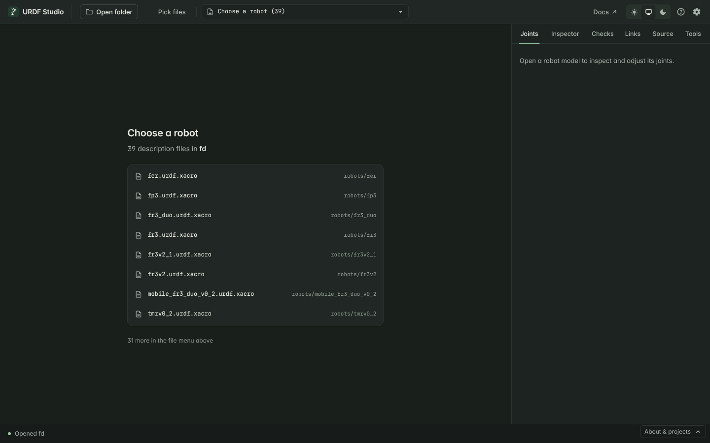

# Your first robot

This walk-through uses the browser version and a public robot package, so
you can try everything before opening your own work. It takes about two
minutes. If you prefer VS Code, see [Use it in VS Code](./vscode.html).

## 1. Get a robot package

Any ROS package with a `.urdf` or `.xacro` file works. If you don't have
one at hand, download Franka's description package:

```bash
git clone --depth 1 https://github.com/frankarobotics/franka_description
```

On a machine without Git, use **Code → Download ZIP** on the
[GitHub page](https://github.com/frankarobotics/franka_description) and
unzip it.

## 2. Open it

1. Go to [urdf.deyuf.org](https://urdf.deyuf.org) in Chrome, Edge or
   another Chromium-based browser.
2. Click **Open folder** and choose the `franka_description` folder — the
   one that contains `package.xml`. You can also drag the folder onto the
   page.
3. Your browser asks whether the page may view the folder. Allow it. The
   files stay on your computer.

> Using Firefox or Safari? Click **Pick files** instead and choose the same
> folder. See [Browser support](../reference/formats.html#browser-support).

## 3. Choose a robot

The page lists the robot files it found, complete robots first. Click
`fr3.urdf.xacro`.

The arm appears in a few seconds. The status bar at the bottom shows
progress while meshes load.



## 4. Look around

- **Drag** to orbit, **right-drag** to pan, **scroll** to zoom.
- Click **Fit** in the top-left to frame the whole robot again.
- Click any part of the arm. The **Inspector** tab shows its name, parent
  joint, mass and meshes.

## 5. Move a joint

Open the **Joints** tab and drag the `fr3_joint4` slider. The arm moves as
you drag. Type a value into the number field for an exact angle.

## 6. Check the model

Open the **Checks** tab. It lists everything URDF Studio thinks could be
wrong with the model, grouped by kind. For this arm you will see a few
links without an `<inertial>` block — harmless sensor frames here, but the
kind of thing a simulator cares about. Click a problem to jump to the line
in the **Source** tab.

## Next steps

- [Pose the robot](../features/joints.html) — limits, mimic joints, saved
  poses.
- [Find and fix problems](../features/diagnostics.html) — what each check
  means.
- [Use it in the browser](./web.html) — reopening folders, browser support,
  privacy.
